# 阶段 3：流程与原型

> 状态：初稿 v0.3（2026-11-04）
> 上游：[01-明确目标](01-明确目标.md) · [02-功能需求](02-功能需求.md)
> 参考：旧项目 Flutter 客户端 `reference/eduagent/mobile/lib/` 和“雅典娜”HTML 设计稿 `reference/eduagent/指导/前端设计/雅典娜美化方案.html`
> 原则：**沿用旧项目的页面骨架和交互**，只改不合理的地方，再补上新功能需要的页面（班级、作业、学情、教师工作台）。
> 流程图使用 Mermaid（GitHub、VS Code、Typora 可以直接渲染）。原型是低保真线框，只表达页面上有什么、点了去哪里；视觉在阶段 4 确定，届时以雅典娜设计稿为基础。

## 0. 与旧项目的对应关系

### 0.1 已经确定的结构调整

| 旧设计 | 新设计 | 状态 |
|---|---|---|
| 学生打开 App 直接进入“对话” | 保留，对话仍是首页 | ✅ 已确认 |
| “知识卡片”是一级 Tab，和错题本各用一套复习 | Tab 改名为“复习”：到期的错题和卡片在同一个队列，沿用翻卡和“忘记 / 模糊 / 记得”交互；卡片本身仍是加分项 | ✅ 已确认 |
| 聊天页工具栏 4 个按钮 +“更多”里 8 个 | 精简为“拍照答疑”“作业批改”（加分项完成后再加“作文批改”“口语对练”）；联网搜索、公式和方程式渲染自动生效；去掉页面跳转类按钮 | ✅ 已确认 |
| 同一 App 在“我的”里切换学生 / 教师 / 家长；教师功能是一个 Tab，备课从聊天弹窗发起 | 注册时确定身份；教师使用独立的工作台导航 | ✅ 已确认 |
| “学习计划”页（今日安排 + 去看看 / 去复习 / 去提问） | 改造为“今日”Tab：待完成作业、到期复习、推荐练习 | ✅ 已确认 |

### 0.2 页面对照

| 旧页面 / 模块 | 新页面 | 处理 |
|---|---|---|
| 登录 / 注册（验证码、游客、第三方） | C-01 / C-02 | 调整：改为账号密码；游客改为体验模式 |
| 对话页（新对话、示例问题、分步讲解卡片、工具栏、输入框） | S-01 对话 | 沿用：保留分步讲解卡片；增加引导式交互 |
| 聊天历史 | S-02 会话历史 | 沿用 |
| 工具 Sheet：拍照答疑、作业批改 | S-03～S-07 | 沿用入口，补齐识别和批改结果页 |
| 工具 Sheet：文档解析、公式助手、化学方程式、知识点检测、联网搜索 | — | 删除（见 0.1） |
| 工具 Sheet：口语对练（voice 页）、作文辅导 | S-28、S-29 | 加分项 |
| 学习计划页 | S-08 今日 | 改造 |
| 错题本（学科筛选、讲解、变式练习） | S-13 / S-14 | 沿用，调整卡片上的掌握度（见问题 Q1） |
| 错题历史 | — | 删除（见问题 Q3） |
| 知识卡片（AI 出题设定、翻卡、忘记 / 模糊 / 记得） | S-16 / S-17 / S-27 | 改造为复习 Tab，翻卡交互沿用 |
| 卡片历史 | S-27 卡片组 | 改造（见问题 Q4） |
| 我的：访客 / 登录、资料 | C-04 / C-05 | 沿用 |
| 我的：会员与额度 | — | 删除 |
| 我的：历史记录、收藏 | — | 见问题 Q3、Q5 |
| 我的：我的教辅（书架） | — | 删除（资料库已砍） |
| 我的：设置（主题、学习阶段、讲解方式、减少动效） | C-06 | 沿用，调整选项（见问题 Q2、Q6） |
| 我的：隐私与数据（导出、重置） | — | 删除 |
| 我的：帮助与反馈 | C-07 | 沿用 |
| 我的：身份切换、模型选择、API Key、设备管理、绑定手机号、教师认证 | — | 删除 |
| 教师工作台 Tab（生成资源列表） | T-01 工作台、T-10 备课列表 | 改造 |
| PPT / 教案 / 试卷生成 Sheet | T-11～T-17 | 改造为独立页面 |
| 学情分析 Sheet（上传 CSV 或选错题）+ 学情报告页 | T-18～T-20 | 改造：数据来自作业 |
| 订阅购买页 | — | 删除 |
| —（旧项目没有） | 班级、作业、批改复核、学情画像、练习、知识点详情 | 新增 |

### 0.3 旧设计中不合理、需要你确认的地方

| # | 旧设计 | 问题 | 建议 |
|---|---|---|---|
| Q1 | 每张错题卡片上显示一个掌握度百分比（如 65%） | 掌握度应该属于**知识点**，不属于单道题；一道题只有“做对 / 做错”和复习进度。两套口径会让学生困惑：一道题显示 65%，它所在的知识点却显示 48 | 错题卡片显示**复习状态**（待复习 / 复习中 · 第 2 次 / 已掌握）和下次复习时间；掌握度只在学情画像和知识点上显示 |
| Q2 | 讲解方式有三种：循序引导、先看结论、举例理解 | “举例理解”和另外两种不是同一个维度：前两种决定**给答案的节奏**，“举例理解”是**讲法**，可以和任何节奏组合 | 只保留两种：**引导式**（默认）、**直接讲解**；“举个例子”做成回答下面的一个追问按钮 |
| Q3 | 对话、错题本、卡片各有一个“历史记录”页，“我的”里还有一份历史记录 | 同一份数据有四个入口，而且错题本本身就是列表，再加一个“错题历史”（最近查看过哪些错题）意义不大 | 只保留对话的会话历史；错题本、复习不再单独做历史页；“我的”里不再放历史记录 |
| Q4 | 卡片“AI 出题”生成后**替换**当前卡组并重置进度 | 生成一次就丢掉上一组，学生做过的卡片没法再复习，违背间隔复习的初衷 | 每次生成都保存成一个新卡组，卡片进入复习队列 |
| Q5 | “我的收藏”可以收藏对话回答 | 阶段 2 里没有这个功能；收藏的回答和错题本作用有重叠 | 不做收藏：值得留下来的题直接加入错题本 |
| Q6 | 学习阶段选项：小学 / 初中 / 高中 / 自主学习 | 第一版只做初中 | 改成年级：七 / 八 / 九年级 |
| Q7 | 手机底部最多放 5 个 Tab。按已确认的结构，学生端需要：对话、今日、错题本、复习、作业、我的，一共 6 个 | 放不下 | “作业”并进“今日”Tab：今日 Tab 顶部切换“今日任务 / 全部作业”。Web 端侧边栏空间足，作业单独列出 |

## 1. 信息架构

### 1.1 导航结构

| 端 | 导航方式 | 一级入口 |
|---|---|---|
| 学生 · Android | 底部 Tab | **对话** · 今日 · 错题本 · 复习 · 我的 |
| 学生 · Web | 左侧边栏（沿用雅典娜设计稿：“开启新对话”按钮 + 导航 + 最近会话） | 对话 · 今日任务 · 作业 · 错题本 · 复习 · 学情 · 我的 |
| 教师 · Web | 左侧边栏 | 工作台 · 班级 · 作业 · 备课 · 组卷 · 学情 · AI 助教 · 我的 |
| 教师 · Android | 底部 Tab | 工作台 · 作业 · 学情 · 我的 |

- 学生端的学情画像：Android 从“今日”的学情卡片和“我的”进入；Web 是一级入口
- 教师 Android 端是轻量版：可以查看班级、作业、学情，可以复核和发布，可以用 AI 助教；备课和组卷只能查看和导出，新建和编辑时提示“请在电脑上打开雅典娜 Web 端”
- 体验模式下，所有页面顶部常驻“切换到老师视角 / 学生视角”

### 1.2 页面地图

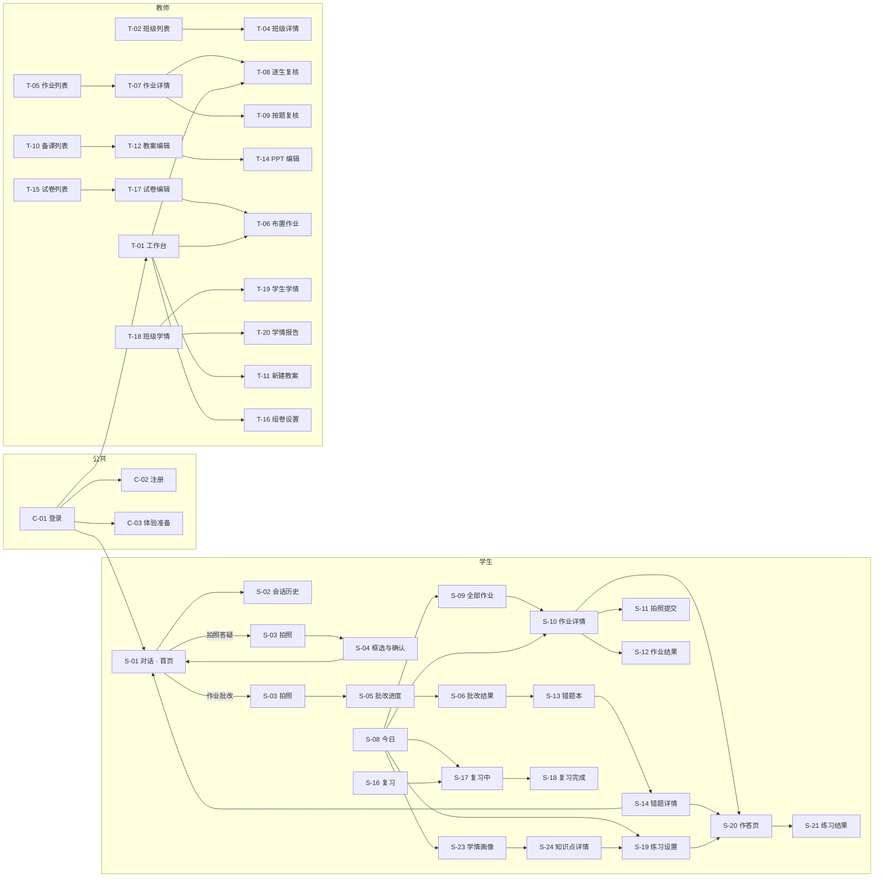

## 2. 页面清单

### 2.1 公共

| ID | 页面 | 端 | 入口 | 主要内容 | 对应需求 |
|---|---|---|---|---|---|
| C-01 | 登录 | 全部 | 启动未登录 / 退出 | 用户名、密码、登录、去注册、体验学生端、体验教师端 | ACC-02, ACC-04 |
| C-02 | 注册 | 全部 | C-01 | 选身份 → 填账号密码 → 补充资料 | ACC-01 |
| C-03 | 体验准备 | 全部 | C-01 体验入口 | 生成体验数据的进度、失败重试 | ACC-04 |
| C-04 | 我的 | 全部 | Tab | 头像昵称、各入口列表（学生和教师的内容不同） | ME |
| C-05 | 编辑资料 | 全部 | C-04 | 昵称 / 姓名、头像、年级 / 任教信息 | ME-01 |
| C-06 | 设置 | 全部 | C-04 | 主题（纸感书房 / 夜间自习 / 跟随系统）、讲解方式和常用学科（学生）、减少动态效果、修改密码、退出登录 | ME-02～04 |
| C-07 | 帮助与反馈 | 全部 | C-04 | 常见问题、隐私说明、关于和版本 | ME-05 |
| C-08 | 消息中心 | 全部 | 顶栏铃铛 | 消息列表，点击跳到对应页面（加分） | MSG |

### 2.2 学生端

| ID | 页面 | 入口 | 主要内容 | 出口 | 对应需求 | 旧项目 |
|---|---|---|---|---|---|---|
| S-01 | 对话（首页） | Tab / 启动 | 空状态：标语 + 示例问题；对话中：消息流、分步讲解卡片、学科选择、讲解方式切换；工具栏（拍照答疑、作业批改）；输入框 | S-02, S-03, S-20（变式题）, 加入错题本弹窗 | ASK-01～05 | 沿用 |
| S-02 | 会话历史 | S-01 顶栏（Web 在侧边栏） | 搜索、会话列表、重命名、删除 | S-01 | ASK-04 | 沿用 |
| S-03 | 拍照 | S-01 工具栏 / 输入框相机 / S-15 | 取景、相册；模式由入口决定，可以在页内切换 | S-04, S-05 | SCAN-01 | 新增 |
| S-04 | 框选与确认 | S-03（拍照答疑） | 裁剪框 → 识别结果（可编辑）→ 开始讲解 | S-01 | SCAN-02 | 新增 |
| S-05 | 批改进度 | S-03（作业批改） | 分阶段进度，可以离开页面 | S-06 | SCAN-03 | 新增 |
| S-06 | 批改结果 | S-05 / S-07 | 原图标注、汇总、逐题列表、加入错题本 | S-01, S-13 | SCAN-03 | 新增 |
| S-07 | 批改记录 | C-04 | 历次批改列表 | S-06 | SCAN-04 | 新增 |
| S-08 | 今日 | Tab | 顶部切换“今日任务 / 全部作业”；今日任务：待完成作业、到期复习、推荐练习、本周学情卡片 | S-10, S-17, S-19, S-23, S-09 | HOME | 改造自学习计划页 |
| S-09 | 全部作业 | S-08 切换（Web 为一级） | 待完成 / 已提交 / 已批改，按班级筛选；没有班级时引导加入 | S-10, S-26 | HW-02 | 新增 |
| S-10 | 作业详情 | S-08 / S-09 | 要求、截止时间、状态及对应操作 | S-20, S-11, S-12 | HW-03 | 新增 |
| S-11 | 拍照提交 | S-10 | 多页拍照、排序、预检提示、提交 | S-10 | HW-03 | 新增 |
| S-12 | 作业结果 | S-10 | 总分、评语、逐题对错和得分、解析 | S-14 | GRD-03 | 新增 |
| S-13 | 错题本 | Tab | 学科筛选、今日复习入口、错题卡片（讲解 / 变式练习）、手动添加 | S-14, S-17, S-15 | MIS-02 | 沿用 |
| S-14 | 错题详情 | S-13 / S-24 | 题目、作答、答案解析、错因、笔记、操作 | S-01, S-20 | MIS-03, MIS-04 | 新增 |
| S-15 | 添加错题 | S-13 | 拍照或输入题目、填写答案、选择知识点 | S-14 | MIS-01 | 新增 |
| S-16 | 复习 | Tab | 今日到期数和“开始复习”；复习统计；卡片组列表和“AI 生成卡片”（加分） | S-17, S-27 | REV | 改造自知识卡片 |
| S-17 | 复习中 | S-16 / S-13 / S-08 | 一题一卡：题目 → 翻面看答案 → 忘记 / 模糊 / 记得 | S-18 | REV-02 | 沿用翻卡交互 |
| S-18 | 复习完成 | S-17 | 本次统计、明天待复习数、再来一轮 | S-16 | REV-03 | 沿用 |
| S-19 | 练习设置 | S-08 / S-23 / S-24 | 学科、知识点、题量、难度 | S-20 | PRC-01 | 新增 |
| S-20 | 作答页 | S-19 / S-14 / S-10 / S-01 | 进度、题目、作答区、上一题 / 下一题、提交（练习、变式题、在线作业共用） | S-21 / S-10 | PRC-02, HW-03 | 新增 |
| S-21 | 练习结果 | S-20 | 得分、逐题对错和解析、掌握度变化 | S-14, S-19 | PRC-03 | 新增 |
| S-22 | 练习记录 | C-04 | 历次练习列表 | S-21 | PRC-04 | 新增 |
| S-23 | 学情画像 | S-08 学情卡片 / C-04（Web 为一级） | 学科切换、章节知识点掌握度、薄弱列表、趋势 | S-24, S-19 | PRO-02 | 新增 |
| S-24 | 知识点详情 | S-23 | 说明、掌握度、作答记录、相关错题 | S-19, S-01, S-14 | PRO-03 | 新增 |
| S-25 | 我的班级 | C-04 | 班级列表、退出班级 | S-26, S-09 | CLS-04 | 新增 |
| S-26 | 加入班级 | S-25 / S-09 空状态 | 输入邀请码 → 确认班级信息 → 填班级内姓名 | S-25 | CLS-02 | 新增 |
| S-27 | 卡片组 | S-16 | 卡片组列表、新建、AI 生成（加分） | S-17 | PRC-06 | 改造 |
| S-28 | 口语对练 | S-01 工具栏 | 选话题、语音对话、反馈（加分） | — | PRC-05 | 旧 voice 页 |
| S-29 | 作文批改 | S-01 工具栏 | 拍照 / 输入作文、批改结果（加分） | — | PRC-05 | 旧作文辅导 |

### 2.3 教师端

| ID | 页面 | 入口 | 主要内容 | 出口 | 对应需求 | 旧项目 |
|---|---|---|---|---|---|---|
| T-01 | 工作台 | 一级 | 待复核作业、进行中作业、班级学情摘要、快捷入口（布置作业、写教案、组卷） | T-07, T-08, T-06, T-11, T-16, T-18 | — | 改造 |
| T-02 | 班级列表 | 一级 | 班级卡片、新建班级、已归档 | T-03, T-04 | CLS-03 | 新增 |
| T-03 | 创建班级 | T-02 | 名称、学科、年级 → 显示邀请码 | T-04 | CLS-01 | 新增 |
| T-04 | 班级详情 | T-02 | 邀请码、学生名单、该班作业、学情入口、归档 | T-07, T-18, T-19 | CLS-03 | 新增 |
| T-05 | 作业列表 | 一级 | 按班级 / 状态筛选、布置作业 | T-07, T-06 | HW-04 | 新增 |
| T-06 | 布置作业 | T-01 / T-05 / T-17 | 选题目来源 → 设置项 → 预览 → 发布 | T-07 | HW-01 | 新增 |
| T-07 | 作业详情 | T-05 / T-01 | 三个 Tab：提交情况 / 批改复核 / 作业分析 | T-08, T-09 | GRD-02, ANA-03 | 新增 |
| T-08 | 逐生复核 | T-07 | 左边原图或作答，右边 AI 判分；改分、评语、上一个 / 下一个、发布 | T-07 | GRD-02 | 新增 |
| T-09 | 按题复核 | T-07 | 同一道题全班有疑问的作答，批量确认或改分 | T-07 | GRD-02 | 新增 |
| T-10 | 备课列表 | 一级 | 教案 / PPT 两个 Tab，搜索，新建 | T-11, T-12, T-13, T-14 | PREP-05 | 改造自工作台资源列表 |
| T-11 | 新建教案 | T-10 / T-01 | 学科、年级、课题、课时、课型、关联班级、补充要求 | T-12 | PREP-01 | 改造自生成 Sheet |
| T-12 | 教案编辑 | T-11 / T-10 | 流式生成 → 编辑、选中段落 AI 改写、导出 Word、生成 PPT | T-13 | PREP-02, PREP-03 | 新增 |
| T-13 | 新建 PPT | T-10 / T-12 | 来源（教案 / 课题）、页数、模板 | T-14 | PREP-04 | 改造自生成 Sheet |
| T-14 | PPT 编辑 | T-13 / T-10 | 生成进度 → 缩略图 + 单页预览、改文字、AI 重写本页、增删排序、导出 | — | PREP-04 | 改造自预览页 |
| T-15 | 试卷列表 | 一级 | 我的试卷、新建、复制、删除 | T-16, T-17 | PAPER-02 | 新增 |
| T-16 | 组卷设置 | T-15 / T-01 | 学科、年级、知识点范围、题型和题量、难度分布、总分 | T-17 | PAPER-01 | 改造自生成 Sheet |
| T-17 | 试卷编辑 | T-16 / T-15 | 题目列表、换题、编辑、改分、检查提示、导出、布置为作业 | T-06 | PAPER-01, PAPER-02 | 新增 |
| T-18 | 班级学情 | 一级 / T-04 | 班级和时间选择、核心指标、知识点热力图、高频错题、需关注学生 | T-19, T-20 | ANA-01 | 新增 |
| T-19 | 学生学情 | T-18 / T-04 | 掌握度、成绩趋势、错因分布 | T-20 | ANA-02 | 新增 |
| T-20 | 学情报告 | T-18 / T-19 | 生成 → 编辑 → 导出 | — | ANA-04 | 改造自学情报告页 |
| T-21 | AI 助教 | 一级 | 和 S-01 结构相同；没有讲解方式切换和加入错题本 | — | ASK-07 | 沿用对话页 |
| T-22 | 个人题库 | T-15 | 筛选、录入（加分） | T-17 | PAPER-03 | 新增 |

合计：公共 8 页、学生 29 页（其中 3 页是加分项）、教师 22 页（其中 1 页是加分项）。

## 3. 业务流程

每张流程图中，**橙色节点是异常分支**。

### F-01 登录、注册与体验

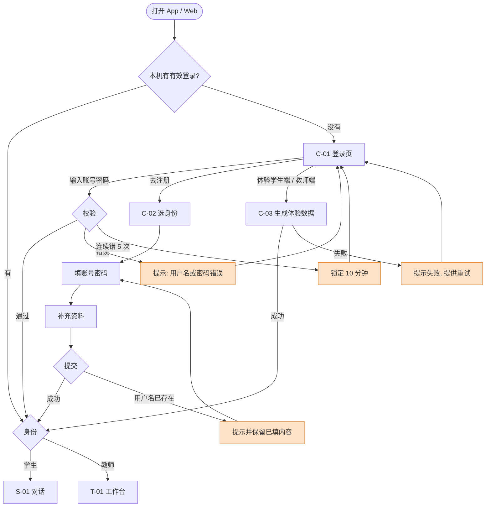

### F-02 AI 答疑（引导式）

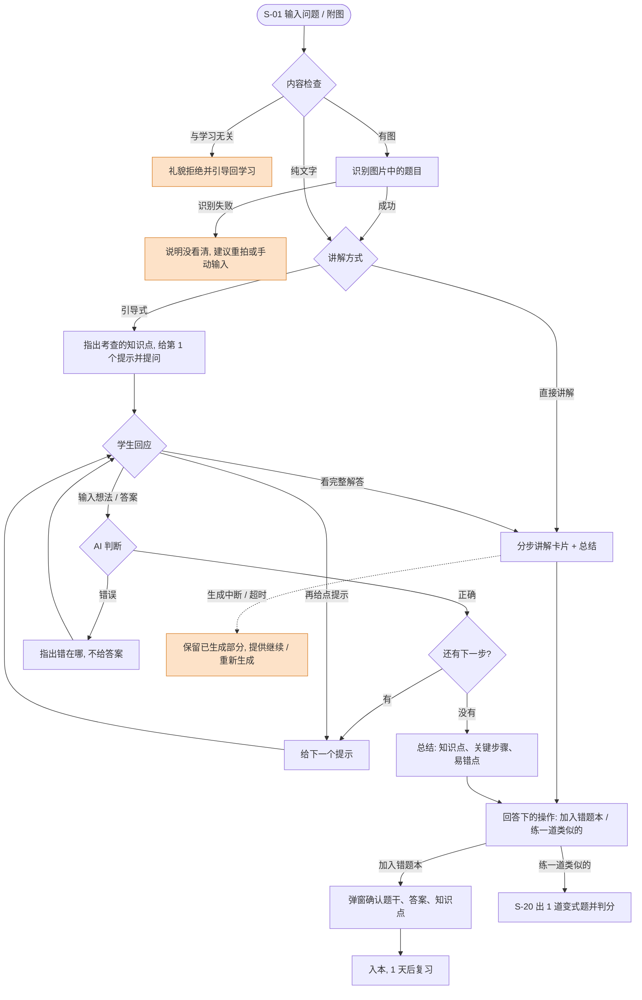

引导式和直接讲解都用旧项目的**分步讲解卡片**（带序号的步骤）呈现。区别是：引导式一次只展开一步，等学生回应后再出下一步；直接讲解一次全部展开。

### F-03 拍照答疑

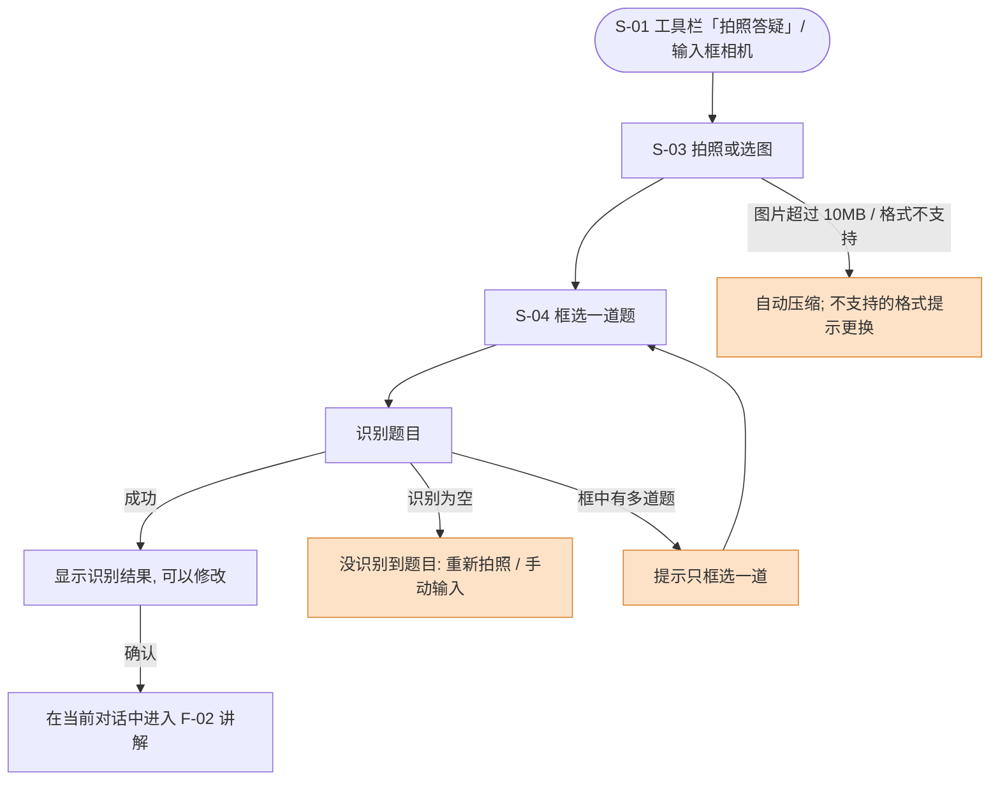

### F-04 作业批改（整页）

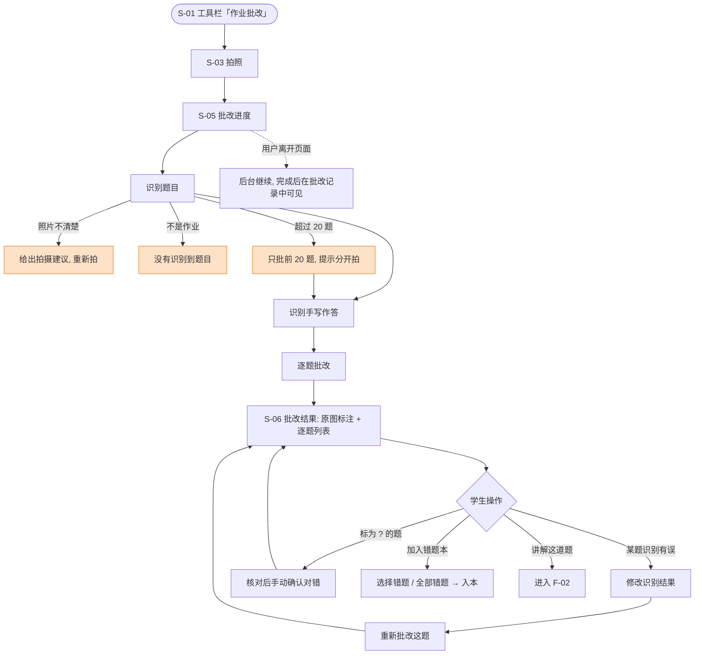

### F-05 错题的生命周期

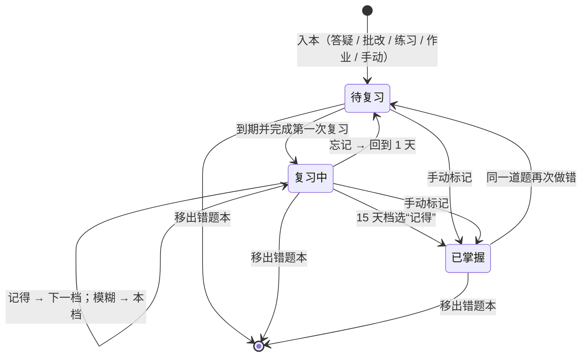

- 复习间隔：1 → 2 → 4 → 7 → 15 天
- 自评按钮沿用旧项目的“忘记 / 模糊 / 记得”
- 卡片（加分项）走同一套状态和间隔

### F-06 练习

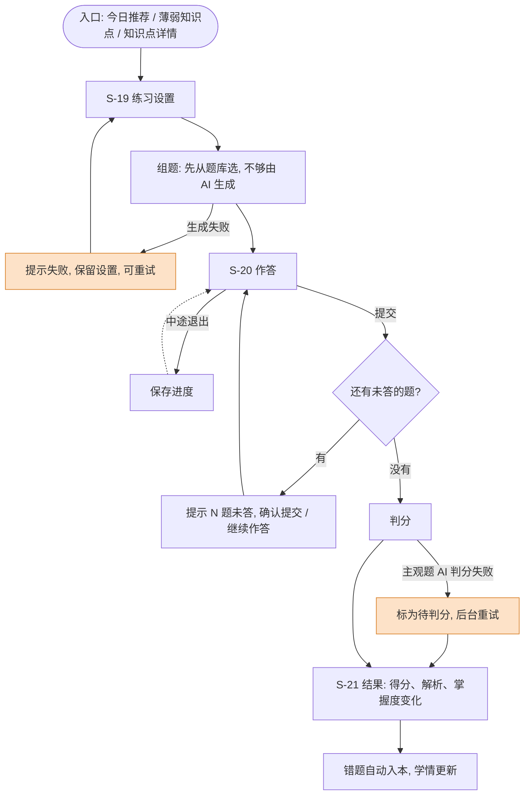

### F-07 加入班级

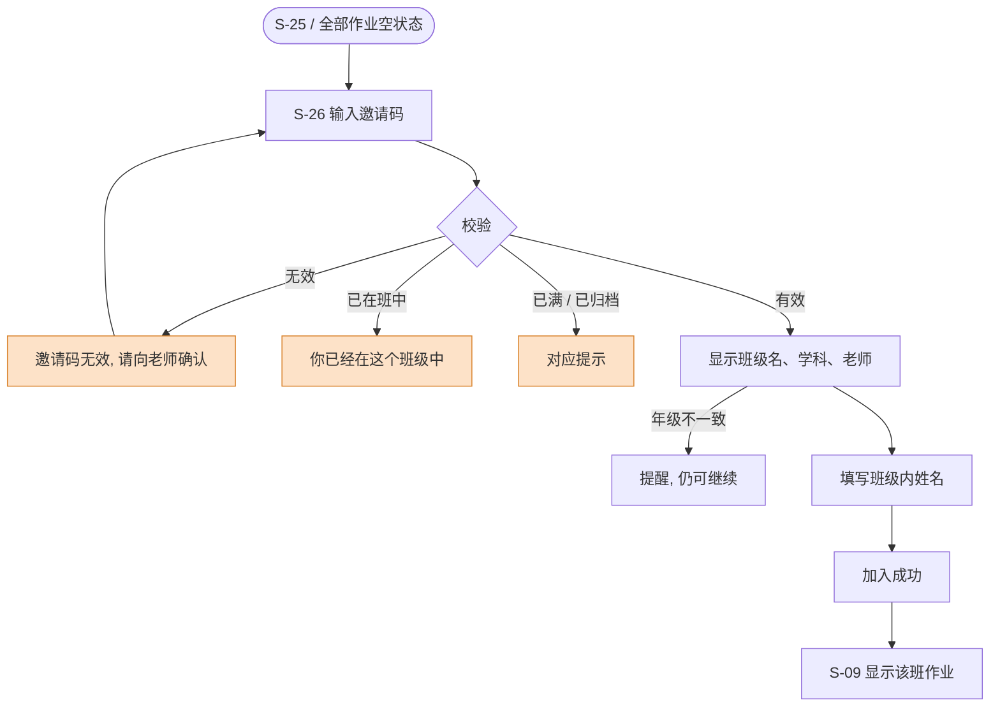

### F-08 作业全流程（师生闭环）

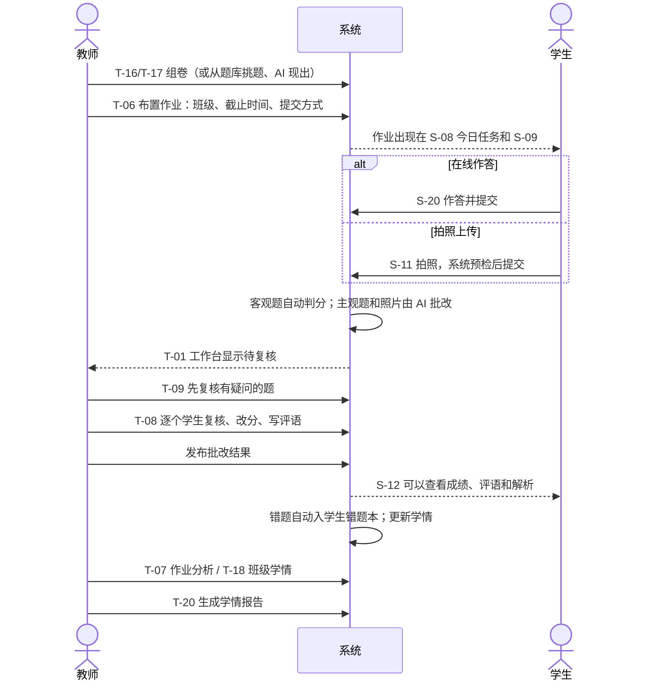

### F-09 一份作业提交的状态

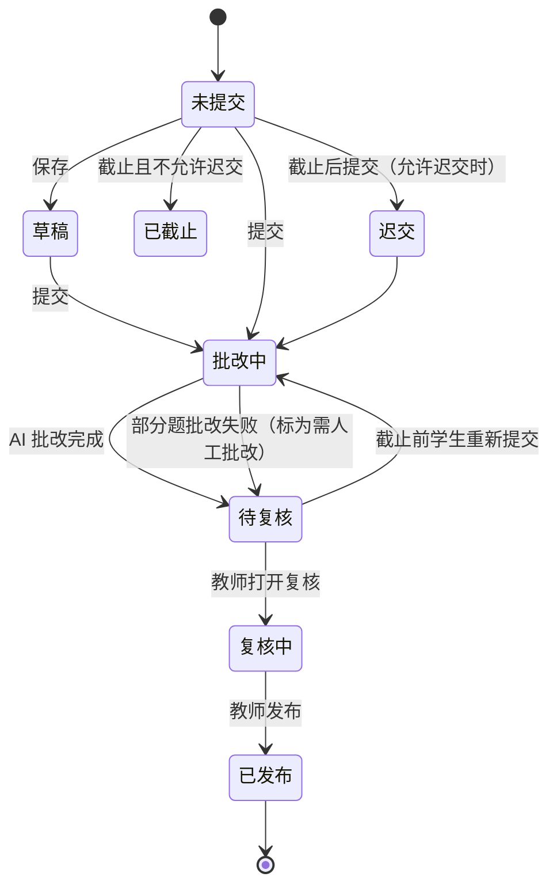

- 教师打开复核后，学生不能再重新提交
- 作业层面的状态（进行中 / 已截止 / 已全部发布）由所有学生的提交状态汇总得到

### F-10 备课：教案到 PPT

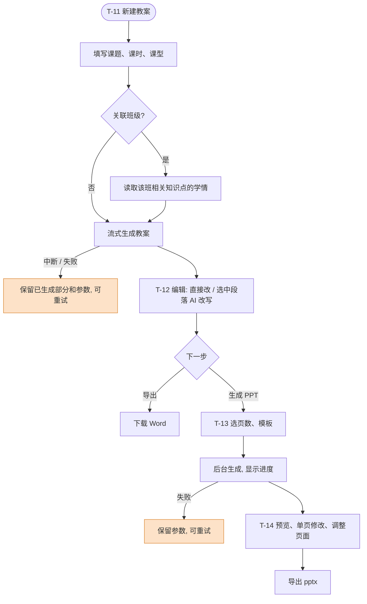

### F-11 组卷到布置

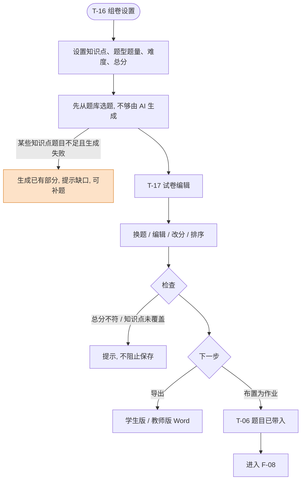

### F-12 学情报告

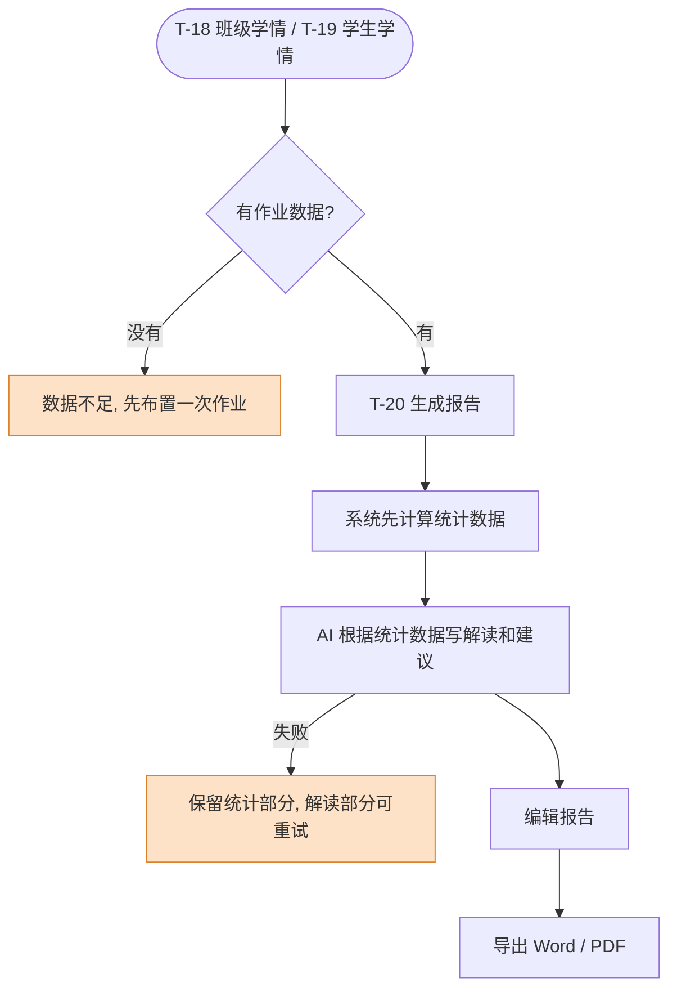

## 4. 演示主线（答辩用，约 8 分钟）

| 步骤 | 视角 | 操作 | 展示的亮点 |
|---|---|---|---|
| 1 | 学生 | 登录页点“体验学生端”，进入对话页；切到“今日”看今日任务 | 体验模式、今日任务 |
| 2 | 学生 | 回到对话页点“作业批改”，拍一页数学作业 → 逐题批改 → 错题加入错题本 | 亮点 1：整页批改 |
| 3 | 学生 | 点一道错题“讲解这道题”，用引导式一步步做出来 | 亮点 2：引导式讲解 |
| 4 | 学生 | 练一道变式题；打开学情画像，看到知识点掌握度变化 | 亮点 4：学情画像 |
| 5 | 教师 | 点顶部“切换到老师视角”，在 Web 上组一份物理卷，布置给班级 | 亮点 5：一键组卷 |
| 6 | 学生 | 切回学生，在“今日”里打开作业，拍照提交 | 亮点 3：师生闭环 |
| 7 | 教师 | 按题复核 → 发布；看班级知识点热力图，生成学情报告 | 亮点 3、4 |
| 8 | 教师 | 根据报告里的薄弱点生成下节课的教案和 PPT | 亮点 5：数据驱动备课 |

第 6、7 步的 AI 批改需要等待，现场可以先展示一份已经提交好的虚拟学生作业。

## 5. 低保真原型

线框中，`[按钮]` 表示可点击，`( )` 表示单选，`[x]` 表示复选，`▾` 表示下拉，`→` 后面写点击后去哪个页面。

### C-01 登录

```
┌───────────────────────────────
│            雅典娜
│     连接学生和老师的 AI 学习助手
│
│  用户名  [______________________]
│  密码    [______________________]
│
│  [            登 录            ]
│  还没有账号？[去注册] → C-02
│
│  ─────────── 免注册体验 ───────────
│  [ 体验学生端 ]   [ 体验教师端 ]  → C-03
└───────────────────────────────
```

### S-01 对话 · 首页（Android，沿用旧对话页）

```
空状态
┌───────────────────────────────
│ [历史] → S-02   雅典娜   [+ 新对话]
│
│          知其然，也知其所以然。
│     让每一个问题，都有值得追寻的答案。
│
│ 从一个问题开始
│ [这道一元二次方程怎么解？]
│ [浮力和排开水的体积有什么关系？]
│ [现在完成时什么时候用？]
│
│ [拍照答疑] → S-03→S-04   [作业批改] → S-03→S-05
│ ┌─────────────────────────────
│ │ [相机] 输入你的学习问题……   [发送]
│ └─────────────────────────────
├───────────────────────────────
│ [对话]  [今日]  [错题本]  [复习]  [我的]
└───────────────────────────────

对话中（引导式）
┌───────────────────────────────
│ ← 勾股定理求边长    数学▾  [引导式▾]
│
│                [图片] 求 AB 的长度
│ 雅典娜：这道题考查【勾股定理】。
│ ┌ ① 找直角 ─────────────────
│ │ 图里哪个角是直角？这决定了哪条边是斜边。
│ └───────────────────────────
│                     角 C 是直角
│ 雅典娜：对！
│ ┌ ② 列式子 ─────────────────
│ │ 斜边是哪一条？试着列出勾股定理的式子。
│ └───────────────────────────
│   [再给点提示]  [看完整解答]
│
│ [拍照答疑]  [作业批改]
│ [相机] 输入你的想法……          [发送]
└───────────────────────────────

完整解答后，回答下方出现：
│ [加入错题本] [练一道类似的] [举个例子] [复制] [重新生成]
```

### S-04 框选与确认

```
┌───────────────────────────────
│ ←  框选一道题
│ ┌─────────────────────────────
│ │ （照片）
│ │      ┏━━━━━━━━━━━━━━┓
│ │      ┃ 拖动框选题目 ┃
│ │      ┗━━━━━━━━━━━━━━┛
│ └─────────────────────────────
│ [重拍]                     [识别]
└───────────────────────────────
          ↓ 识别完成
┌───────────────────────────────
│ ←  确认题目
│ 识别结果（可编辑）：
│ [如图，在 Rt△ABC 中，∠C=90°，
│  AC=3，BC=4，求 AB 的长。      ]
│ 学科：(•)数学 ( )物理 ( )英语
│ [        开始讲解        ] → S-01
└───────────────────────────────
```

### S-06 批改结果

```
┌───────────────────────────────
│ ←  批改结果           12 月 3 日
│ 共 10 题 · 对 7 · 错 2 · 待确认 1
│ ┌─────────────────────────────
│ │ （原图，每题旁标注 ✓ ✗ ?）
│ └─────────────────────────────
│ ✗ 第 3 题  勾股定理
│   你的答案：5√2   正确答案：5
│   错因：计算失误    [讲解这道题] → S-01
│ ? 第 6 题  没有看清你的作答
│   [修改识别结果]  [我做对了] [我做错了]
│ ✓ 第 1 题 ……
│
│ [ 把 2 道错题加入错题本 ]
└───────────────────────────────
```

### S-08 今日（改造自学习计划页）

```
┌───────────────────────────────
│ 12 月 3 日 星期三
│ [今日任务]  [全部作业] → S-09
│
│ 今日任务                         2/4
│ ● 作业 · 二次根式练习  今晚 20:00 截止 → S-10
│ ● 复习 · 6 道题到期        [去复习] → S-17
│ ○ 推荐 · 勾股定理（掌握度 48）[去练习] → S-19
│ ✓ 作业 · Unit 3 阅读（已提交）
│
│ 本周学情                    [查看] → S-23
│ 作答 86 题 · 正确率 74% · 连续 5 天
│ 最弱：勾股定理 48 · 浮力 52 · 定语从句 55
│
│ “学习不是填满容器，而是让思考发生。”
├───────────────────────────────
│ [对话]  [今日]  [错题本]  [复习]  [我的]
└───────────────────────────────
```

### S-13 错题本（沿用，按 Q1 调整卡片内容）

```
┌───────────────────────────────
│ 错题本                    [+ 添加] → S-15
│      温故，而知新。
│ ┌─────────────────────────────
│ │ 今日待复习 6 道      [开始复习] → S-17
│ └─────────────────────────────
│ [全部] [数学] [物理] [英语]   知识点▾  状态▾
│
│ ┌ 数学 · 勾股定理 ─────────────── → S-14
│ │ 已知 Rt△ABC 中……求 AB 的长。
│ │ 留意：开方时别忘了化简。
│ │ 复习中 · 第 2 次 · 明天复习 · 错 2 次
│ │ [讲解] → S-01    [变式练习] → S-20
│ └───────────────────────────────
│ ┌ 物理 · 浮力 ───────────────────
│ │ ……
├───────────────────────────────
│ [对话]  [今日]  [错题本]  [复习]  [我的]
└───────────────────────────────
```

### S-14 错题详情

```
┌───────────────────────────────
│ ←  错题详情                [更多▾]
│ 勾股定理 · 拍照批改 · 错 2 次
│ 题目：……
│ 我的答案：5√2
│ 正确答案：5
│ 解析：① …… ② …… ③ ……
│ 错因：[计算失误▾]
│ 笔记：[__________________________]
│ 复习：第 2 次 · 下次 12 月 5 日
│
│ [讲解这道题] → S-01   [练变式题] → S-20
│ 更多：标记已掌握 / 移出错题本
└───────────────────────────────
```

### S-16 复习（改造自知识卡片）

```
┌───────────────────────────────
│ 复习          让知识，留下来。
│ ┌─────────────────────────────
│ │ 今日到期  6 道错题 · 4 张卡片
│ │ [         开始复习         ] → S-17
│ └─────────────────────────────
│ 本周已复习 32 次 · 记得 68%
│ 已掌握 12 道 · 复习中 27 道
│
│ 我的卡片组（加分项）    [AI 生成卡片] → S-27
│ 数学 · 二次根式公式      8 张
│ 英语 · 现在完成时        12 张
├───────────────────────────────
│ [对话]  [今日]  [错题本]  [复习]  [我的]
└───────────────────────────────
```

### S-17 复习中（沿用翻卡交互）

```
┌───────────────────────────────
│ ×  今日复习                2 / 10
│ ┌─────────────────────────────
│ │ 错题 · 数学 · 勾股定理
│ │
│ │ 已知 Rt△ABC 中，∠C=90°……
│ │ 求 AB 的长。
│ │
│ │       轻点卡片，查看答案
│ └─────────────────────────────
│ 不用急着翻面，先给自己一点思考的时间。
│      ↓ 翻面后
│ 答案：5    解析：① …… ②……
│ [ 忘记 ]    [ 模糊 ]    [ 记得 ]
└───────────────────────────────
```

### S-20 作答页（练习 / 变式题 / 在线作业共用）

```
┌───────────────────────────────
│ ×  勾股定理练习     3/10     05:12
│ ━━━━━━━━━░░░░░░░░░░░░░░░░░░░░
│ 【单选】直角三角形两直角边为 6 和 8，
│ 斜边长为（  ）
│ ( ) A. 9    ( ) B. 10
│ ( ) C. 12   ( ) D. 14
│
│ ——解答题时作答区变为——
│ [输入作答过程……              ]
│ [拍照上传手写过程]
│
│ [上一题]     [答题卡]     [下一题]
│                        [提交] → S-21
└───────────────────────────────
```

### S-23 学情画像

```
┌───────────────────────────────
│ ←  学情画像     [数学] [物理] [英语]
│ 平均掌握度 71  · 近 4 周 ↑ 6
│ （折线：4 周趋势）
│
│ 第十七章 勾股定理
│   勾股定理         ■■■□□ 48 薄弱 → S-24
│   勾股定理的逆定理 ■■■■□ 76 一般
│ 第十六章 二次根式
│   二次根式的乘除   ■■■■■ 90 掌握
│   二次根式的加减   ····· 数据不足
│
│ 薄弱知识点
│ 勾股定理 48        [去练习] → S-19
└───────────────────────────────
```

### S-10 作业详情（按状态显示不同内容）

```
┌───────────────────────────────
│ ←  二次根式练习
│ 八年级 3 班 · 数学 · 李老师
│ 截止：今晚 20:00（还剩 3 小时）
│ 共 12 题 · 提交方式：在线或拍照
│
│ 状态 = 未提交：
│   [ 在线作答 ] → S-20   [ 拍照提交 ] → S-11
│ 状态 = 待批改：
│   已提交 18:02 · 截止前可以重新提交
│ 状态 = 已发布：
│   得分 86 / 100       [查看批改结果] → S-12
└───────────────────────────────
```

### S-11 拍照提交

```
┌───────────────────────────────
│ ←  拍照提交
│ [第1页] [第2页] [+ 拍一页]   （可拖动排序）
│
│ 预检结果：
│ ✓ 识别到第 1～12 题
│ ! 第 9 题没有识别到作答    [重拍第2页]
│
│ [         确认提交         ]
└───────────────────────────────
```

### S-01 对话 · Web 端（沿用雅典娜设计稿布局）

```
┌──────────────┬──────────────────────────────────────
│ 雅典娜       │                         [夜间自习] [头像]
│ [+ 开启新对话]│
│              │        知其然，也知其所以然。
│ 对话         │
│ 今日任务  2  │   从一个问题开始
│ 作业      1  │   [这道一元二次方程怎么解？] ……
│ 错题本    6  │
│ 复习      10 │
│ 学情         │
│ 我的         │   [拍照答疑] [作业批改]
│ ──────────   │   ┌──────────────────────────────────
│ 最近对话     │   │ 输入你的学习问题……            [发送]
│ 勾股定理求边长│   └──────────────────────────────────
│ 浮力的方向   │   Enter 发送 · Shift + Enter 换行
└──────────────┴──────────────────────────────────────
```

### T-01 教师工作台（Web）

```
┌──────────┬──────────────────────────────────────────
│ 雅典娜   │ 李老师，下午好                    [铃铛] [头像]
│          │
│ 工作台   │ [+ 布置作业]  [+ 写教案]  [+ 组卷]
│ 班级     │
│ 作业     │ 待复核                                   [全部]
│ 备课     │ 二次根式练习 · 八(3) · 38/42 已交 · 待复核 35 → T-07
│ 组卷     │ 浮力小测   · 八(5) · 40/40 已交 · 待复核 4  → T-07
│ 学情     │
│ AI 助教  │ 进行中的作业
│ 我的     │ Unit 3 阅读 · 八(3) · 截止 12/5 · 已交 20/42
│          │
│          │ 班级学情速览                              → T-18
│          │ 八(3) 数学 · 平均掌握度 71 · 最弱：勾股定理
└──────────┴──────────────────────────────────────────
```

### T-06 布置作业

```
┌──────────┬──────────────────────────────────────────
│ 侧边栏   │ 布置作业                   ① 选题 ② 设置 ③ 预览
│          │
│          │ ① 题目来源
│          │   (•) 选一份试卷  [二次根式单元卷▾]
│          │   ( ) 从题库挑题
│          │   ( ) AI 按知识点出题
│          │
│          │ ② 设置
│          │   标题      [二次根式练习______________]
│          │   班级      [x] 八(3)  [ ] 八(5)
│          │   截止时间  [2026-12-05 20:00]
│          │   提交方式  ( )在线 ( )拍照 (•)两者都可
│          │   允许迟交  [x]
│          │   答案可见  (•)发布结果后 ( )截止后
│          │
│          │                       [上一步] [预览并发布]
└──────────┴──────────────────────────────────────────
```

### T-07 作业详情

```
┌──────────┬──────────────────────────────────────────
│ 侧边栏   │ ← 二次根式练习 · 八(3) · 截止 12/5 20:00
│          │ [提交情况]  [批改复核]  [作业分析]
│          │
│          │ 提交情况：已交 38 · 迟交 2 · 未交 2
│          │ 未交：张三 王五              [复制名单]
│          │
│          │ 批改复核：AI 已批 38 · 有疑问 11 题次
│          │ [先看有疑问的题] → T-09    [逐个学生复核] → T-08
│          │ [全部发布]
│          │
│          │ 作业分析：每题正确率柱状图 · 得分分布 · 常见错误答案
└──────────┴──────────────────────────────────────────
```

### T-08 逐生复核

```
┌──────────┬───────────────────────┬──────────────────
│ 学生列表 │ 张小雅 · 第 2/38 个     │ AI 判分
│ ✓ 王一   │                       │ 第 1 题 ✓ 5/5
│ ● 张小雅 │ （作答原图，可缩放）    │ 第 2 题 ✗ 0/5
│ ○ 李二   │                       │ 第 3 题 ! 3/8  置信度低
│ ○ ……     │                       │   扣分：第二步漏开方
│          │                       │   得分 [3] 评语 [____]
│          │                       │ ……
│          │                       │ 总分 86   整体评语 [____]
│          │                       │ [上一个] [确认并下一个]
└──────────┴───────────────────────┴──────────────────
```

### T-12 教案编辑

```
┌──────────┬──────────────────────────────────────────
│ 侧边栏   │ ← 17.1 勾股定理（第 1 课时）  已保存
│          │ [导出 Word]  [生成 PPT] → T-13  [另存一份]
│          │ ─────────────────────────────────────────
│          │ 一、教学目标
│          │   1. ……
│          │ 二、重点难点
│          │   ……（参考八(3)学情：勾股定理掌握度 48）
│          │ 三、教学过程
│          │   环节 1 情境导入（5 分钟）……
│          │   ┌ 选中文字后浮出 ─────────
│          │   │ [AI 扩写] [AI 精简] [换一种讲法]
│          │   └─────────────────────────
└──────────┴──────────────────────────────────────────
```

### T-14 PPT 编辑

```
┌──────────┬────────┬─────────────────────────────────
│ 侧边栏   │ 缩略图 │ 第 3 页                [导出 pptx]
│          │ [ 1 ]  │ ┌──────────────────────────────
│          │ [ 2 ]  │ │ 标题：勾股定理的发现
│          │ [▶3 ]  │ │ · 毕达哥拉斯的故事
│          │ [ 4 ]  │ │ · ……
│          │ ……     │ └──────────────────────────────
│          │ [+页]  │ [编辑文字]  [AI 重写本页]  [删除本页]
└──────────┴────────┴─────────────────────────────────
生成中：显示“正在生成第 8/15 页”，已生成的页可以先看。
```

### T-17 试卷编辑

```
┌──────────┬──────────────────────────────────────────
│ 侧边栏   │ ← 二次根式单元卷   总分 100 ✓   知识点覆盖 5/5 ✓
│          │ [导出学生版] [导出教师版] [布置为作业] → T-06
│          │ ─────────────────────────────────────────
│          │ 一、单选题（每题 3 分，共 30 分）
│          │ 1. …… [AI 生成]        [换一题] [编辑] [分值 3]
│          │ 2. ……                  [换一题] [编辑] [分值 3]
│          │ 二、填空题 ……
│          │ 三、解答题 ……
│          │ [+ 添加题目]                  （拖动可排序）
└──────────┴──────────────────────────────────────────
```

### T-18 班级学情

```
┌──────────┬──────────────────────────────────────────
│ 侧边栏   │ 班级 [八(3) 数学▾]  范围 [最近一个月▾]  [生成报告] → T-20
│          │ 完成率 95%  平均分 78  正确率 74%
│          │
│          │ 知识点热力图
│          │ 第十六章  二次根式  ■■ ■■ ■□
│          │ 第十七章  勾股定理  ■□ □□ ■■    （颜色 = 掌握度）
│          │
│          │ 高频错题 TOP10              需要关注的学生
│          │ 1. 第 3 题 错误率 62%        张三 掌握度 45  → T-19
│          │ 2. ……                       ……
└──────────┴──────────────────────────────────────────
```

## 6. 待确认

1. 第 0.3 节的 Q1～Q7，每条都给了建议，你逐条确认或修改。
2. 教师 Android 端只做轻量版（不能新建备课和组卷），可以吗？
3. ~~是否做 HTML 可点击原型~~ → 已完成，见下方说明。

## 7. 可点击原型

[`prototype/index.html`](prototype/index.html)：单个 HTML 文件，直接用浏览器打开，不需要安装任何东西。

- 左栏：切换四个端（学生手机 / 学生 Web / 教师 Web / 教师手机）、开关体验模式、按页面 ID 跳转
- 中间：页面本身，按钮都可以点击跳转
- 右栏：本页对应的需求编号、**所有状态和异常**（点击切换）、本页能跳转到的页面
- 地址栏可以定位到某一页，便于分享：`index.html#T-08@tw`（页面 ID，`@` 后面是端：`sp` 学生手机、`sw` 学生 Web、`tw` 教师 Web、`tp` 教师手机），也可以带状态，例如 `#S-10:已发布@sp`
- 黄色虚线框是设计备注；Q1～Q7 按建议方案绘制，确认后再同步修改
