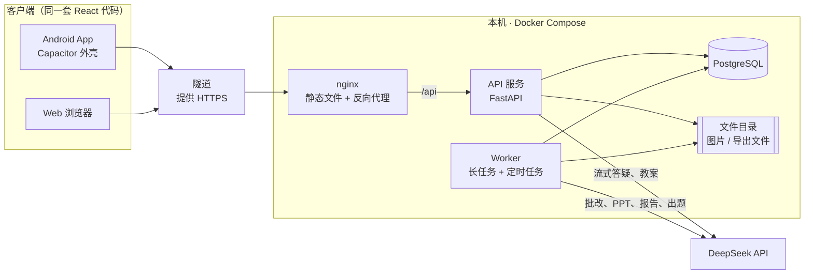
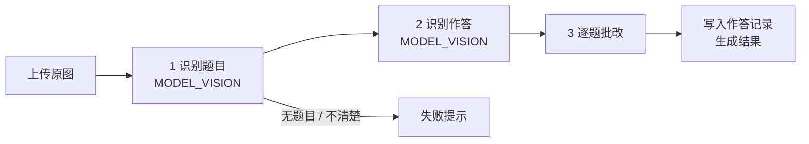

# 阶段 5：技术方案

> 状态：初稿 v0.1（2026-11-04）
> 上游：[02-功能需求](02-功能需求.md) · [03-流程与原型](03-流程与原型.md) · [04-UI设计](04-UI设计.md)
> 同阶段：[05-数据库设计](05-数据库设计.md) · [05-接口约定](05-接口约定.md)

## 1. 原则

- **一套客户端代码、一个后端服务**。旧项目拆了 7 个服务，核心功能却还是 mock（01 第 6 节第 9 条）。这次只在确实需要时才加组件
- 先把两条演示主线跑通，再做加分项
- 模型的输出都当作外部输入：在入口校验一次结构，校验不过就重试或报错，不把不合格的数据存进库

## 2. 总体架构



- API 和 Worker 是**同一份代码**的两个启动入口，共用数据模型和 AI 调用
- 长任务通过数据库里的任务表交给 Worker（见第 6 节），不引入 Redis 或其他消息队列
- 文件存在服务器本地目录，访问链接由 API 签发，带有效期（见第 8 节）

## 3. 技术栈

### 3.1 客户端

| 用途 | 选型 | 说明 |
|---|---|---|
| 语言 / 构建 | TypeScript + Vite | |
| 框架 | React | 旧项目 Web 端用的也是 React |
| Android 打包 | Capacitor | 同一份构建产物打包成 APK；拍照和相册先用 `<input type="file">`，Web 和 App 同一套代码，App 里由 WebView 调起系统相机和相册；真机上不好用再换 `@capacitor/camera` |
| 路由 | React Router | |
| 数据请求 | TanStack Query | 管理缓存、重试、加载状态 |
| 接口类型 | openapi-typescript + openapi-fetch | 根据后端 OpenAPI **自动生成**，不手写 |
| 样式 | 原生 CSS + CSS Modules | 直接沿用设计稿的 CSS 变量，不引入 Tailwind 或组件库 |
| Markdown / 公式 | markdown-it + KaTeX | AI 回答、题目、解析统一按 Markdown + LaTeX 渲染 |
| 富文本编辑 | TipTap | 教案、学情报告编辑 |
| 图表 | ECharts | 热力图、趋势图、得分分布 |
| 图片裁剪 | Cropper.js | 拍照框选（SCAN-02） |

### 3.2 服务端

| 用途 | 选型 | 说明 |
|---|---|---|
| 语言 / 框架 | Python 3.12 + FastAPI | 自动生成 OpenAPI |
| 数据库 | PostgreSQL 16 | 唯一的存储；同时承担任务队列、登录锁定、体验次数统计 |
| ORM / 迁移 | SQLAlchemy 2（async）+ Alembic | |
| 数据校验 | Pydantic 2 | 请求参数、模型输出结构都用它校验 |
| 模型调用 | openai SDK | DeepSeek 兼容 OpenAI 协议 |
| 图片处理 | Pillow + pillow-heif | 统一转成 JPEG，长边压到 2048px，处理 heic |
| 数学验算 | SymPy | 填空题等价判断、计算题答案校验 |
| 文档导出 | Pandoc（Word）、LibreOffice（Word 转 PDF）、python-pptx（PPT） | Pandoc 能把 LaTeX 公式转成 Word 原生公式 |
| 密码哈希 | argon2-cffi | |
| 依赖管理 | uv | `uv.lock` 锁定版本，镜像构建时 `uv sync --frozen` |

### 3.3 工程

| 用途 | 选型 |
|---|---|
| 后端测试 | pytest，连真实 PostgreSQL |
| 前端测试 | Vitest（逻辑）、Playwright（两条演示主线的端到端测试） |
| 代码检查 | ruff（Python）、ESLint + Prettier（TypeScript） |
| 部署 | Docker Compose |

## 4. 仓库结构

```text
/
├── docs/                 阶段文档、原型
├── web/                  客户端（React）
│   ├── src/
│   │   ├── api/          由 OpenAPI 生成的类型（生成物，不手改）
│   │   ├── styles/       设计变量，来自原型
│   │   ├── components/   通用组件
│   │   ├── lib/          与页面无关的工具（存储、格式化等）
│   │   └── pages/        按 03 的页面 ID 组织：student/、teacher/、common/
│   └── android/          Capacitor 生成的 Android 工程
├── server/
│   ├── app/
│   │   ├── api/          路由，按模块拆文件
│   │   ├── schemas/      接口的请求和响应模型（Pydantic）
│   │   ├── models/       数据表
│   │   ├── services/     业务逻辑
│   │   ├── ai/           模型调用、提示词、输出结构
│   │   ├── jobs/         长任务处理函数
│   │   └── worker.py     Worker 入口
│   ├── prompts/          提示词文件，随代码版本管理
│   ├── seed/             知识点、预置题库、体验模式模板数据
│   ├── migrations/       Alembic
│   └── tests/
├── eval/                 评测集和评测脚本
└── deploy/               docker-compose、nginx 配置（不含域名和密钥）
```

## 5. AI 设计

### 5.1 模型

只接 DeepSeek。模型名写在配置里，不写进代码。

| 配置项 | 默认模型 | 用途 |
|---|---|---|
| `MODEL_FAST` | `deepseek-flash` | 答疑讲解、AI 助教、会话标题、错题信息提取、教案和 PPT 文字生成、改写 |
| `MODEL_VISION` | `deepseek-flash` | 拍照识题、整页识别、手写作答识别（需要看图的调用） |
| `MODEL_REASONING` | `deepseek-v4-pro`（思考模式） | 解答题批改、出题与变式题、答案校验、填空题等价判断、学情报告 |

- 答疑要求首字 ≤ 3 秒，所以讲解默认用 `MODEL_FAST`；评测发现讲解正确率不达标时，再评估换成思考模式
- `deepseek-flash` 默认开思考模式。`MODEL_FAST`、`MODEL_VISION` 调用时关掉思考（实测答疑首字从约 2.4 秒降到约 1.5 秒），只有 `MODEL_REASONING` 开
- 每个配置项都可以另配一个**备用模型**（OpenAI 兼容协议的任意服务，可以是另一家）。主模型连续失败时切到备用模型，满足 18.6 的兜底要求；备用模型选哪家，等评测后再定
- **手写识别**：2026-11-04 拿 30 张真实作业照片快速试跑（开发文档 3.6），印刷体 96%、手写 82%，低分主要是红笔订正和划掉的字混进作答、模糊照片上编答案，不是字认不出。所以**不加专门 OCR**，在整页批改里加清晰度检查、逐题裁图识别、看不清标“？”；正式准确率在阶段 7 的评测集上测

### 5.2 通用约定

- 提示词放在 `server/prompts/`，按“学科 × 场景”拆文件，统一带上未成年人安全约束（18.5）
- 需要结构化结果的调用一律要求模型输出 JSON，用 Pydantic 校验；不合格就重试，最多 2 次，仍失败按各功能的异常规则处理
- 题目、讲解、解析统一用 **Markdown + LaTeX**（行内 `$...$`，独立公式 `$$...$$`）
- 每次调用记录日志：场景、模型、耗时、token 数、是否失败。不记录密钥，不记录图片内容

### 5.3 答疑（ASK）

- 系统提示词由“角色（学生 / 教师）× 学科 × 讲解方式”拼装；学科选“自动识别”时由模型自己判断
- **引导式**：提示词要求每次只给一步提示，并以一个问题结尾。“再给点提示”“看完整解答”“举个例子”“重新生成”作为**动作**发给后端，后端换成对应的指令再交给模型，不作为学生的原话显示
- 会话上下文：带最近 20 轮；更早的内容压缩成一段摘要
- “继续生成”用 DeepSeek 的前缀续写（beta 地址）：把已中断的内容作为回答开头交给模型接着写，接缝处不会重复
- 回答一开始就写入库，状态先记为“已中断”，正常结束后改成“完成”；服务中途异常退出时留下的就是已中断
- 会话标题：发出第一个问题时，和回答并行生成（只看问题），回答结束前存好，前端刷新列表就能看到
- **加入错题本**：用 `MODEL_FAST` 从对话中提取题目结构（题干、答案、知识点），学生确认后入本
- **练一道类似的**：走 5.6 的出题流程，生成 1 道题

### 5.4 拍照识题与整页批改（SCAN）

**识题**（SCAN-02，同步请求）：客户端裁剪后上传 → `MODEL_VISION` 识别出题目结构 → 返回给学生确认和修改 → 作为一条用户消息进入答疑。

**整页批改**（SCAN-03，长任务）：



1. **识别题目**：输出每道题的题号、题型、题干、选项，以及在原图上的大致位置（归一化坐标框）和识别置信度
2. **识别作答**：针对每道题，识别学生写下的答案
3. **逐题批改**：
   - 客观题由代码按 KP-04 的规则判分，题目答案先由 `MODEL_REASONING` 解出
   - 解答题由 `MODEL_REASONING` 先解题，再按评分要点判“对 / 部分对 / 错”，并给出错因
   - 识别置信度低的题目标为“？”，不判分
4. 每完成一个阶段就更新任务进度，客户端据此展示分阶段进度

✓ / ✗ / ？ 标在模型给出的坐标框旁边。坐标框不准时只是标记位置偏一点，不影响批改结果；评测时会一并检查定位效果。

**作业拍照提交**（HW-03）走同一条流程，只是第 1 步换成“把作答和这份作业的已知题目对齐”：题目已经知道了，只识别作答。

### 5.5 判分（KP-04）

判分规则写在代码里，模型只处理代码判断不了的部分：

| 题型 | 判分方式 |
|---|---|
| 单选、判断 | 代码精确匹配 |
| 多选 | 代码按“全对满分、少选一半、错选 0” |
| 填空 | ① 去掉空格、统一全角和半角后比对 → ② 都能解析成数学表达式的，用 SymPy 判断是否等价 → ③ 还不一致，交给 `MODEL_REASONING` 判断（如单位写法不同） |
| 解答 | `MODEL_REASONING` 按题目的评分要点逐条给分，输出得分、扣分点、置信度 |
| 完形、阅读 | 按小题拆开，每小题按上面的规则判 |

AI 判分失败的题目，状态记为“待判分”，交给 Worker 重试（PRC-03）；作业里失败的记为“需人工批改”（GRD-01）。

### 5.6 出题与答案校验（MIS-04、PRC-01、PAPER-01）

所有出题场景共用同一个出题服务：

1. 先从预置题库按“知识点 + 题型 + 难度”选题，排除这个学生最近做过的题
2. 不够的部分由 `MODEL_REASONING` 生成（变式题要求同知识点、同难度，换情境或数字）
3. **校验**（02 留到本阶段决定）：
   - 另起一次调用，**不给答案**，让模型独立解一遍，再比对两次的答案（比对方式同 5.5 的填空题）
   - 数学、物理的计算题，生成时要求同时给出可以用 SymPy 验算的表达式，验算不通过的直接丢弃
   - 变式题再检查一次：和原题文本相似度过高的丢弃
4. 校验不过的重新生成，最多 3 次；仍不够时，按各功能的异常规则提示

校验通过的 AI 题存进题库（来源记为“AI 生成”，归属于发起人），后面可以复用。

### 5.7 备课（PREP）

- **教案**：`MODEL_FAST` 按固定的章节结构流式生成 Markdown；关联了班级时，先查出这个班相关知识点的掌握度，一起放进提示词。存储格式是 Markdown，编辑器 TipTap 读写 Markdown
- **选中段落 AI 改写**：只把选中的段落和前后文发给模型，返回的结果替换选中部分
- **PPT**：长任务。先由模型输出逐页的 JSON（页面类型、标题、要点、讲稿备注），存进库；前端按 3 套模板渲染预览；导出时由 python-pptx 套用对应的 `.pptx` 模板文件生成。改单页只重新生成这一页的 JSON
- **导出 Word**：Markdown 经 Pandoc 转成 docx，使用统一的参考模板控制字体和版式；试卷也走这条路（学生版去掉答案）

### 5.8 学情报告（ANA-04）

1. 代码先算出统计数据（JSON），作为报告的“数据部分”存档
2. `MODEL_REASONING` 只拿到这份统计数据，写解读和建议
3. **防止编造数字**：生成后检查正文里出现的每个数字，都必须能在统计数据里找到；找不到就重新生成，最多 2 次，仍不过就删掉这句
4. 解读失败时，保留统计部分，解读可以单独重试（F-12）

### 5.9 内容安全（18.5）

- **输入**：先过本地敏感词表；命中的不调用模型，直接返回正向引导
- **输出**：流式输出时也逐段检查；命中后立即停止，把这条消息替换成“这个问题我没办法回答”，并记录日志
- 负面情绪识别写在提示词里，由模型处理
- DeepSeek 平台自带的内容审核作为第二道防线

## 6. 长任务与定时任务

**长任务**：整页批改、作业批改、PPT 生成、学情报告、AI 判分重试。

- 发起时往 `jobs` 表写一条记录，接口立即返回任务 ID
- Worker 循环用 `SELECT ... FOR UPDATE SKIP LOCKED` 取任务执行，执行过程中更新阶段和进度
- 客户端每 2 秒查询一次任务状态；离开页面不影响任务执行，回到原入口能看到结果（02 第 16 节）
- 失败自动重试，间隔 10 秒、60 秒，共 3 次。只有模型超时、模型服务出错和程序异常才重试；“照片不清楚”这类业务错误重试也不会变，直接失败
- 处于“执行中”、但超过 10 分钟没有更新阶段和进度的任务算卡住（比如 Worker 被重启），Worker 启动时和之后每分钟检查一次，按失败处理（还能重试的放回队列）
- 最终失败时，任务对应的资源（如 `scans`）也一起标成失败

**流式任务**：答疑和教案生成不走任务表，由 API 直接通过 SSE 推送。客户端断开时，已经生成的部分照样保存，标记为“已中断”。

**定时任务**（由 Worker 执行）：

| 任务 | 频率 |
|---|---|
| 清理过期体验账号及其数据和文件 | 每天 1 次 |
| 清理过期会话 token | 每天 1 次 |
| 清理没有被引用的上传文件（超过 24 小时） | 每天 1 次 |

## 7. 关键业务规则的实现

### 7.1 掌握度（PRO-01，02 留到本阶段决定）

对一个学生的一个知识点，取最近 10 条**已计入**的作答记录，按时间从新到旧编号 i = 1…n：

```text
得分率 s_i = 得分 / 满分（0～1）
权重   w_i = 0.8^(i-1)
掌握度 = round(100 × Σ(w_i × s_i) / Σw_i)
```

- n < 3 时显示“数据不足”
- 一道题关联多个知识点时，同一条作答计入每个知识点
- 复习只有自评、没有作答时，按“记得 1 / 模糊 0.5 / 忘记 0”算得分率
- **什么时候计入**：练习、拍照批改、变式题判分完成即计入；**作业要等老师发布**才计入，避免学生在看到成绩之前先看到掌握度变化
- 教师视角（ANA）只用这个班级作业产生的作答记录，按同一个公式计算（第 17 节）
- **实时计算，不建缓存表**。按试用规模（一个班 + 评委），一次查询就能算完；真的慢了再加缓存
- 趋势图（最近 4 周）：在每周末这个时间点，用当时已有的作答记录重新算一遍

### 7.2 复习调度（REV-01）

错题记录“当前档位”（0～4，对应间隔 1 / 2 / 4 / 7 / 15 天）和下次复习时间：

| 事件 | 档位 | 下次复习 |
|---|---|---|
| 入本 / 再次做错 | 0 | 1 天后 |
| 记得 | +1（在第 4 档选记得 → 已掌握） | 新档位的间隔 |
| 模糊 | 不变 | 当前档位的间隔 |
| 忘记 | 0 | 1 天后 |

“今天”“1 天后”都按北京时间的自然日计算：下次复习时间存日期，不存时刻。

### 7.3 体验模式（ACC-04）

- 体验数据来自 `server/seed/` 里的一份**模板**：1 个班、30 名虚拟学生、3 次已批改的作业、约 20 道错题、若干段答疑记录。模板里的 AI 内容提前用真实模型生成好，创建体验账号时**不调用模型**，目标 3 秒内完成
- 每次进入体验，都按模板复制出一组新的账号和数据；时间字段整体平移到“现在”，保证到期复习、作业截止时间看起来是真实的
- 一组体验账号共用一个每日 AI 调用计数，达到上限（默认 200 次，可配置）后，AI 类接口返回“今日体验次数已用完”
- 视角切换：后端给同组的另一个账号签发 token，前端替换登录状态后，跳转到对应端的首页

## 8. 安全

- **密码**：argon2 哈希存储
- **登录状态**：登录后签发一个随机 token，数据库只存它的哈希，30 天有效；退出时删除。Web 存在 localStorage，App 存在 Capacitor Preferences。不用 JWT，这样退出和清理体验账号能立即生效
- **登录锁定**：用户表记录连续失败次数和锁定截止时间
- **数据归属**：每个查询都带上当前用户的归属条件；教师访问学生数据时，校验这个学生在他的班里，而且只返回这个班的作业数据。这部分统一写成几个权限函数，在接口层调用
- **文件访问**：上传的文件不能直接访问。API 返回的链接带过期时间和 HMAC 签名（1 小时有效），由 API 校验签名后返回文件
- **密钥**：模型 API Key、签名密钥只放在服务器的 `.env` 文件里，不进 git，不进日志
- **HTTPS**：由隧道提供，服务器本身只监听本机端口

## 9. 部署

- 部署在团队自有的服务器（本机）上，用 Docker Compose 运行 4 个容器：`nginx`、`api`、`worker`、`db`
- **演示环境**和**试用环境**是两套独立的 Compose 项目（数据库、文件目录、端口都分开），各自经隧道对外。域名和隧道配置不写进仓库
- 数据库每天用 `pg_dump` 备份一次，保留 7 天
- 日志输出到标准输出，用 `docker compose logs` 查看
- **Android**：Capacitor 构建出签名的 release APK，服务器地址在构建时写入；APK 放在 Web 端的“下载 App”页面

## 10. 测试与评测

- **后端**：业务逻辑测试连真实 PostgreSQL（测试库）；模型调用只在 HTTP 层替换成录制好的模型响应，不 mock 业务代码
- **前端**：Playwright 跑 01 第 4 节的两条演示主线
- **AI 效果评测**（18.2）：`eval/` 下每科 ≥ 100 道题，评测脚本直接调用服务端的识别、批改、出题函数，输出各项指标。换模型或改提示词之后都要重跑，结果写进答辩用的评测报告

## 11. 开发顺序建议

1. **技术验证**：用 30 张真实作业照片测 `deepseek-flash` 的题目识别和手写识别；测答疑首字延迟。结果决定 5.1 的模型分配要不要调整
2. 骨架：仓库结构、数据库迁移、登录注册、接口类型生成、设计变量和基础组件、Android 打包跑通
3. 知识点和预置题库数据
4. 学生线：答疑 → 拍照批改 → 错题本 → 变式练习 → 复习 → 学情画像
5. 师生线：班级 → 组卷 → 布置作业 → 提交 → 批改 → 复核发布 → 学情 → 报告
6. 备课：教案 → PPT
7. 体验模式 → 部署 → 评测
8. 加分项（按 02 第 19 节的顺序）

## 12. 决策记录

| 日期 | 决策 |
|---|---|
| 2026-11-04 | 客户端：React + TypeScript，一套代码，Android 用 Capacitor 打包 |
| 2026-11-04 | 后端：单体 FastAPI + Worker + PostgreSQL，不拆微服务，不引入 Redis 和对象存储 |
| 2026-11-04 | 模型：只接 DeepSeek |
| 2026-11-04 | 部署：本机 Docker Compose，经隧道对外；域名之后确定，不写进仓库 |
