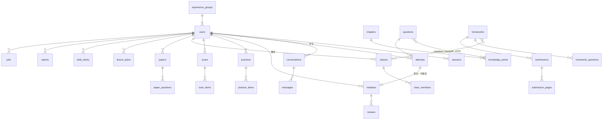

# 阶段 5：数据库设计

> 状态：初稿 v0.1（2026-11-04）
> 同阶段：[05-技术方案](05-技术方案.md) · [05-接口约定](05-接口约定.md)
> 数据库：PostgreSQL 16。表结构以 Alembic 迁移为准，本文是设计依据；两者不一致时先改本文再改迁移

## 1. 约定

- 表名用复数蛇形（`homework_questions`），字段用蛇形
- 主键 `id bigint generated always as identity`；关联表用联合主键
- 时间字段都是 `timestamptz`，存 UTC；按“天”计算的业务（复习、连续学习天数、每日次数）用北京时间的 `date`
- 枚举用 `text` + `CHECK` 约束，不用 PostgreSQL 的 enum 类型，方便以后加值
- 几乎每张表都有 `created_at`；会被修改的表再加 `updated_at`。下文的字段表里省略这两列
- 结构多变、只整体读写的内容（题目内容、批改明细、PPT 页面）用 `jsonb`，结构在第 10 节定义并由 Pydantic 校验
- 删除一律物理删除（02 第 17 节：删除的会话、错题不保留），靠外键 `ON DELETE CASCADE` 级联
- 必填写 `NOT NULL`，字段表里标“可空”的除外

## 2. 总览



| 模块 | 表 |
|---|---|
| 账号（ACC、ME） | `users` `sessions` `experience_groups` |
| 基础数据（KP） | `chapters` `knowledge_points` `questions` `question_knowledge_points` |
| 作答（核心） | `attempts` |
| 答疑（ASK） | `conversations` `messages` |
| 拍照批改（SCAN） | `scans` `scan_items` |
| 错题与复习（MIS、REV） | `mistakes` `reviews` |
| 练习（PRC） | `practices` `practice_items` |
| 班级（CLS） | `classes` `class_members` |
| 作业与批改（HW、GRD） | `homeworks` `homework_classes` `homework_questions` `submissions` `submission_pages` |
| 组卷（PAPER） | `papers` `paper_questions` |
| 备课（PREP） | `lesson_plans` `slide_decks` |
| 学情（ANA） | `reports`；其余统计全部实时查询，不建表 |
| 公共 | `files` `jobs` |

## 3. 账号

### users

学生和教师放在同一张表，按 `role` 区分，各自用到的字段不同。

| 字段 | 类型 | 说明 |
|---|---|---|
| username | text 唯一 | 4～20 位字母、数字、下划线；唯一约束按小写比较 |
| password_hash | text | argon2 |
| role | text | `student` / `teacher`，注册后不能改 |
| display_name | text | 学生是昵称，教师是姓名 |
| avatar | text | 预置头像的编号 |
| grade | smallint 可空 | 学生年级 7 / 8 / 9 |
| teach_subjects | text[] 可空 | 教师任教学科 |
| teach_grades | smallint[] 可空 | 教师任教年级 |
| explain_mode | text 可空 | 学生讲解偏好：`guided`（默认）/ `direct` |
| preferred_subject | text 可空 | 学生常用学科 |
| failed_logins | smallint | 连续输错次数，登录成功后清零 |
| locked_until | timestamptz 可空 | 锁定截止时间 |
| must_change_password | boolean | 老师重置密码后为 true（CLS-06，加分） |
| experience_group_id | bigint 可空 | 体验账号所属组；虚拟学生也有 |
| is_virtual | boolean | 体验模式里的 30 名虚拟学生，不能登录 |

学科统一用 `math` / `physics` / `english`，下同。

### sessions

| 字段 | 类型 | 说明 |
|---|---|---|
| user_id | bigint | |
| token_hash | text 唯一 | token 的 SHA-256 |
| expires_at | timestamptz | 签发后 30 天 |

### experience_groups

| 字段 | 类型 | 说明 |
|---|---|---|
| teacher_id / student_id | bigint | 可以操作的两个账号 |
| class_id | bigint | |
| expires_at | timestamptz | 创建后 7 天，到期由定时任务整组删除 |
| ai_usage_date | date | 计数对应的日期 |
| ai_usage_count | int | 当天已用的 AI 调用次数，日期变了就从 0 开始 |

## 4. 基础数据

### chapters

| 字段 | 类型 | 说明 |
|---|---|---|
| code | text 唯一 | 稳定编号，如 `M8-11`（数学八年级第十一章）、`E-GR`（英语语法）；种子数据重复导入时按它对应 |
| subject | text | |
| grade | smallint 可空 | 英语按维度组织，不分年级时为空 |
| title | text | 如“第十一章 三角形”“时态” |
| sort | int | |

### knowledge_points

| 字段 | 类型 | 说明 |
|---|---|---|
| chapter_id | bigint | |
| code | text 唯一 | 稳定编号，章节编号 + 序号，如 `M8-11-02`；种子数据和评测集用它引用 |
| name | text | |
| description | text | 知识点说明（PRO-03） |
| grades | smallint[] | 适用年级 |
| sort | int | |

知识点和章节都是预置数据，从 `server/seed/` 导入，用户不能修改。

### questions

所有来源的题目都在这张表（KP-02）。

| 字段 | 类型 | 说明 |
|---|---|---|
| subject | text | |
| type | text | `single` 单选 / `multiple` 多选 / `judge` 判断 / `blank` 填空 / `solution` 解答 / `cloze` 完形 / `reading` 阅读 / `essay` 作文（加分） |
| content | jsonb | 题干、选项、配图、小题，见 10.1 |
| answer | jsonb | 标准答案，见 10.1 |
| analysis | jsonb | 分步解析：`[{title, body}]` |
| scoring_points | jsonb 可空 | 解答题评分要点：`[{point, score}]` |
| difficulty | smallint | 1～5 |
| source | text | `preset` / `scan` / `ai` / `teacher` / `manual`（学生手动添加错题） |
| owner_id | bigint 可空 | 预置题为空；其余归创建者 |
| origin_question_id | bigint 可空 | 变式题指向原题 |
| content_text | text | 题干的纯文本，用于搜索和变式题相似度检查 |

“预置题公开，其余只归创建者”：查询题库时条件为 `owner_id IS NULL OR owner_id = 当前用户`。

### question_knowledge_points

| 字段 | 类型 | 说明 |
|---|---|---|
| question_id / knowledge_point_id | bigint | 联合主键；每题 1～3 个，在写入时校验 |

## 5. 作答（核心）

### attempts

一次判分产生一条作答记录，是错题、复习和学情的**唯一数据来源**（KP-04）。

| 字段 | 类型 | 说明 |
|---|---|---|
| student_id | bigint | |
| question_id | bigint | |
| source | text | `practice` / `variant` / `homework` / `scan` / `review` |
| source_id | bigint | 对应的 `practices` / `submissions` / `scans` / `reviews` 的 ID；变式题是 `practices` 或 `messages` |
| answer | jsonb | 学生作答，见 10.2 |
| answer_file_id | bigint 可空 | 解答题拍照上传的手写过程 |
| grading_status | text | `pending` 待判分 / `graded` 已判 / `manual` 需人工批改 |
| result | text 可空 | `correct` / `partial` / `wrong` |
| score / max_score | numeric(5,1) | |
| grading_detail | jsonb 可空 | 每空或每小题的结果、扣分点、置信度，见 10.3 |
| graded_by | text 可空 | `rule` / `ai` / `teacher` |
| error_reason | text 可空 | 错因：`concept` 概念不清 / `calculation` 计算失误 / `reading` 审题错误 / `method` 方法不当 / `careless` 粗心 / `other` |
| teacher_comment | text 可空 | 单题评语（作业） |
| duration_sec | int 可空 | 用时 |
| counted_at | timestamptz 可空 | **计入掌握度的时间**；为空表示还没计入 |

- `counted_at`：练习、变式题、拍照批改、复习判分完成时写入；作业等老师发布时写入（见技术方案 7.1）
- 学生重新提交作业时，删除这份提交旧的作答记录，重新生成
- 索引：`(student_id, counted_at)`、`(source, source_id)`

## 6. 学生端

### conversations

| 字段 | 类型 | 说明 |
|---|---|---|
| user_id | bigint | 学生或教师（AI 助教也用这张表） |
| title | text | 由 AI 生成，可重命名 |
| subject | text 可空 | 为空表示自动识别 |
| explain_mode | text 可空 | 当前讲解方式；教师会话为空 |
| summary | text 可空 | 超过 20 轮后，更早内容的压缩摘要 |
| turn_count | int | 超过 50 轮提示开新会话（ASK-04） |

搜索按标题和消息内容做 `ILIKE`，加 `pg_trgm` 索引。

### messages

| 字段 | 类型 | 说明 |
|---|---|---|
| conversation_id | bigint | |
| role | text | `user` / `assistant` |
| action | text 可空 | 用户消息的动作：`hint` 再给点提示 / `full` 看完整解答 / `example` 举个例子 / `regenerate`；普通提问为空 |
| content | text | Markdown |
| image_file_id | bigint 可空 | 附带的图片 |
| status | text | `done` / `interrupted` 已中断 / `blocked` 被内容安全拦截 |
| question_id | bigint 可空 | 从这条讲解提取出的题目（加入错题本、练类似题时生成） |

### scans 与 scan_items

| scans 字段 | 类型 | 说明 |
|---|---|---|
| student_id | bigint | |
| image_file_id | bigint | 原图 |
| job_id | bigint | 批改任务 |
| status | text | `processing` / `done` / `failed` |
| fail_reason | text 可空 | `unclear` 照片不清楚 / `no_question` 没有识别到题目 |
| total / correct / unknown | smallint | 汇总，`unknown` 是“？”的数量 |

| scan_items 字段 | 类型 | 说明 |
|---|---|---|
| scan_id | bigint | |
| seq | smallint | 题号 |
| bbox | jsonb | 归一化坐标 `{x, y, w, h}` |
| question_id | bigint | 识别出的题目，来源记为 `scan` |
| attempt_id | bigint 可空 | 置信度低（“？”）时为空，不生成作答记录 |
| confidence | real | 识别置信度 |

学生修改识别结果后“重新批改这一题”：更新题目和作答，重新判分，覆盖原来的作答记录。

### mistakes

| 字段 | 类型 | 说明 |
|---|---|---|
| student_id / question_id | bigint | **联合唯一**：同一道题不重复入本（MIS-01） |
| source | text | 第一次入本的来源：`ask` / `scan` / `practice` / `homework` / `manual` |
| last_attempt_id | bigint 可空 | 最近一次做错的作答记录，用来显示“我的作答”；答疑和手动添加的为空 |
| wrong_count | int | 错误次数 |
| error_reason | text 可空 | 默认取作答记录的错因，学生可以改 |
| note | text 可空 | 笔记，≤ 500 字 |
| status | text | `pending` 待复习 / `reviewing` 复习中 / `mastered` 已掌握 |
| review_stage | smallint | 0～4，对应 1 / 2 / 4 / 7 / 15 天 |
| next_review_on | date 可空 | 下次复习日期；已掌握时为空 |
| review_count | int | 已复习次数，用来显示“复习中 · 第 N 次” |

索引：`(student_id, next_review_on)`。

### reviews

| 字段 | 类型 | 说明 |
|---|---|---|
| mistake_id | bigint | |
| student_id | bigint | |
| rating | text | `forgot` / `fuzzy` / `remembered` |
| attempt_id | bigint | 这次复习产生的作答记录：客观题作答了就按实际判分，否则按自评折算得分率 |

复习完成页（REV-03）的统计，直接按当天的 `reviews` 聚合。

### practices 与 practice_items

| practices 字段 | 类型 | 说明 |
|---|---|---|
| student_id | bigint | |
| kind | text | `practice` 练习 / `variant` 变式题 |
| subject | text | |
| knowledge_point_ids | bigint[] | 1～5 个 |
| difficulty | text | `basic` / `advanced` / `challenge` |
| origin_mistake_id | bigint 可空 | 从错题发起的变式练习 |
| status | text | `in_progress` / `grading` 判分中 / `done` |
| current_seq | smallint | 中途退出时停在第几题 |
| submitted_at | timestamptz 可空 | |
| score / max_score | numeric(5,1) 可空 | |

| practice_items 字段 | 类型 | 说明 |
|---|---|---|
| practice_id / seq | | 联合主键 |
| question_id | bigint | |
| draft_answer | jsonb 可空 | 未提交时的作答，中途退出可以继续 |
| attempt_id | bigint 可空 | 提交后生成 |

## 7. 班级与作业

### classes

| 字段 | 类型 | 说明 |
|---|---|---|
| teacher_id | bigint | |
| name | text | |
| subject | text | 一个班级只对应一个学科 |
| grade | smallint | |
| invite_code | text 唯一 | 6 位，字符集排除 0 / O / 1 / I |
| archived_at | timestamptz 可空 | 不为空表示已归档，只读 |

### class_members

| 字段 | 类型 | 说明 |
|---|---|---|
| class_id / student_id | bigint | 联合主键 |
| name_in_class | text | 班级内姓名 |
| joined_at | timestamptz | |

学生退出或被移出班级时直接删除这一行；已经提交的作业和作答记录不受影响（CLS-04）。

### homeworks

| 字段 | 类型 | 说明 |
|---|---|---|
| teacher_id | bigint | |
| title | text | |
| subject | text | |
| paper_id | bigint 可空 | 从试卷布置时记下来源 |
| submit_mode | text | `online` / `photo` / `both` |
| deadline | timestamptz | 至少在发布 1 小时后 |
| allow_late | boolean | |
| answer_visible | text | `after_publish`（默认）/ `after_deadline` |
| withdrawn_at | timestamptz 可空 | 撤回时间；已有学生提交的不能撤回 |

作业发布后不能改题目，所以题目复制一份关联到作业，不引用试卷里的题目顺序和分值。

### homework_classes

| 字段 | 类型 | 说明 |
|---|---|---|
| homework_id / class_id | bigint | 联合主键；同一份作业可以布置给多个同学科班级 |

### homework_questions

| 字段 | 类型 | 说明 |
|---|---|---|
| homework_id / seq | | 联合主键 |
| question_id | bigint | |
| score | numeric(5,1) | 本题分值 |

### submissions

每个学生每份作业**一行**，状态按 03 的 F-09 流转。

| 字段 | 类型 | 说明 |
|---|---|---|
| homework_id / student_id | bigint | 联合唯一 |
| class_id | bigint | 学生是通过哪个班收到的 |
| status | text | `draft` 草稿 / `grading` 批改中 / `to_review` 待复核 / `reviewing` 复核中 / `published` 已发布 |
| draft | jsonb 可空 | 在线作答的草稿 |
| submitted_at | timestamptz 可空 | 最后一次提交时间 |
| is_late | boolean | |
| total_score | numeric(5,1) 可空 | |
| teacher_comment | text 可空 | 整体评语 |
| review_started_at | timestamptz 可空 | 老师第一次打开复核的时间；之后学生不能重交 |
| published_at | timestamptz 可空 | |

- “未提交”“已截止”不存行：没有提交记录、或者有记录但状态还是草稿，就是未提交；“已截止”由截止时间算出来
- 作业层面的状态（进行中 / 已截止 / 已全部发布）由提交状态汇总得到，不单独存

### submission_pages

| 字段 | 类型 | 说明 |
|---|---|---|
| submission_id / seq | | 联合主键；最多 10 页 |
| file_id | bigint | |

## 8. 教师端

### papers 与 paper_questions

| papers 字段 | 类型 | 说明 |
|---|---|---|
| teacher_id | bigint | |
| title | text | |
| subject / grade | | |
| settings | jsonb | 组卷参数：知识点范围、题型和题量、难度分布、总分 |
| target_score | numeric(5,1) | 设置的总分，用来检查“总分是否等于设置” |

| paper_questions 字段 | 类型 | 说明 |
|---|---|---|
| paper_id / seq | | 联合主键 |
| question_id | bigint | 编辑题目时，如果是预置题，先复制一份归自己的题再改 |
| score | numeric(5,1) | |

### lesson_plans

| 字段 | 类型 | 说明 |
|---|---|---|
| teacher_id | bigint | |
| subject / grade | | |
| topic | text | 课题 |
| knowledge_point_ids | bigint[] | 可为空数组（手动输入课题时） |
| class_id | bigint 可空 | 关联的班级 |
| periods | smallint | 课时 1～3 |
| lesson_type | text | `new` 新授 / `review` 复习 / `exercise` 习题 / `lab` 实验 |
| extra | text 可空 | 补充要求，≤ 300 字 |
| content | text | Markdown 正文 |
| status | text | `generating` / `done` / `interrupted` |

### slide_decks

| 字段 | 类型 | 说明 |
|---|---|---|
| teacher_id | bigint | |
| lesson_plan_id | bigint 可空 | 从教案生成时 |
| params | jsonb | 直接按课题生成时的参数，失败重试时用 |
| template | text | 3 套模板之一 |
| slides | jsonb | 逐页内容，见 10.4 |
| status | text | `generating` / `done` / `failed` |
| job_id | bigint 可空 | |

### reports

| 字段 | 类型 | 说明 |
|---|---|---|
| teacher_id | bigint | |
| class_id | bigint | |
| student_id | bigint 可空 | 为空是班级报告 |
| range | text | `last_homework` / `last_month` / `all` |
| stats | jsonb | 生成时的统计数据快照，AI 只能用这里的数字 |
| content | text | Markdown，可编辑 |
| status | text | `generating` / `done` / `failed` |
| job_id | bigint 可空 | |

## 9. 公共

### files

| 字段 | 类型 | 说明 |
|---|---|---|
| owner_id | bigint | |
| kind | text | `image` 上传图片 / `export` 导出文件 |
| path | text | 相对文件目录的路径 |
| mime | text | |
| size | int | |
| width / height | int 可空 | 图片才有 |

上传后 24 小时内没有被任何表引用的文件，由定时任务删除。

### jobs

| 字段 | 类型 | 说明 |
|---|---|---|
| type | text | `scan_grading` / `homework_grading` / `slide_generation` / `report_generation` / `regrade` |
| owner_id | bigint | 发起人，只有本人能查询 |
| payload | jsonb | 任务参数 |
| status | text | `queued` / `running` / `succeeded` / `failed` |
| stage | text 可空 | 当前阶段，如 `recognize_questions` |
| progress | smallint | 0～100 |
| error | text 可空 | 给用户看的错误码 |
| tries | smallint | 已执行次数，最多 3 次 |
| run_after | timestamptz | 重试时往后推 |
| started_at / finished_at | timestamptz 可空 | |

取任务的条件是 `status = 'queued' AND run_after <= now()`，索引 `(status, run_after)`。

## 10. JSON 字段结构

这些结构在服务端用 Pydantic 定义，前后端共用（通过 OpenAPI 生成到前端）。

### 10.1 题目 `questions.content` / `answer`

```jsonc
// content
{
  "stem": "如图，在 $\\triangle ABC$ 中……",       // Markdown + LaTeX
  "images": [101],                                  // files.id
  "options": [{"key": "A", "text": "$30^\\circ$"}], // 选择题
  "blank_count": 2,                                 // 填空题
  "material": "Passage ...",                        // 完形、阅读的材料
  "sub_questions": [                                // 完形、阅读的小题，每个小题自带题型和选项
    {"seq": 1, "type": "single", "stem": "...", "options": [...], "score": 2}
  ]
}

// answer，按题型取其中一种
{"choice": ["B"]}                                   // 单选、多选
{"judge": true}                                     // 判断
{"blanks": [["1/2", "0.5"], ["3"]]}                 // 填空：每空可以有多个等价答案
{"text": "...", "final": "x = 3"}                   // 解答：完整答案 + 最终结果
{"sub": [{"seq": 1, "choice": ["C"]}]}              // 完形、阅读
```

### 10.2 作答 `attempts.answer`

和 `answer` 的结构一一对应：`{"choice": [...]}`、`{"judge": ...}`、`{"blanks": ["...", "..."]}`、`{"text": "..."}`、`{"sub": [...]}`。拍照识别出来的作答也转成同样的结构。

### 10.3 批改明细 `attempts.grading_detail`

```jsonc
{
  "confidence": 0.86,
  "items": [                       // 每空 / 每小题 / 每个评分要点
    {"key": "blank_1", "result": "correct", "score": 2, "max_score": 2},
    {"key": "point_2", "result": "wrong", "score": 0, "max_score": 3, "comment": "没有写出全等的依据"}
  ],
  "summary": "第二步辅助线作法正确，但缺少证明依据"
}
```

### 10.4 PPT 页面 `slide_decks.slides`

```jsonc
[
  {"layout": "cover", "title": "三角形的内角和", "subtitle": "八年级数学"},
  {"layout": "bullets", "title": "学习目标", "bullets": ["……", "……"], "notes": "讲稿备注"},
  {"layout": "two_column", "title": "……", "left": ["……"], "right": ["……"]},
  {"layout": "question", "title": "随堂练习", "question_id": 2033}
]
```

`layout` 固定几种（封面、要点、两栏、图文、例题、小结），3 套模板各自实现这几种版式。

## 11. 加分项预留

加分项开始做时再补表，先确认不影响现在的结构：

| 加分项 | 计划 |
|---|---|
| 记忆卡片（PRC-06） | 新增 `card_decks`、`cards`；复习调度字段和 `mistakes` 一致，复习队列查询两张表合并 |
| 作文批改（PRC-05） | 题型 `essay` 已经预留；批改明细按评分维度放进 `grading_detail` |
| 消息提醒（MSG） | 新增 `notifications` |
| 个人题库（PAPER-03） | 新增 `question_favorites`；教师录入的题直接用 `questions`（来源 `teacher`） |
| 重置学生密码（CLS-06） | `users.must_change_password` 已经预留 |
